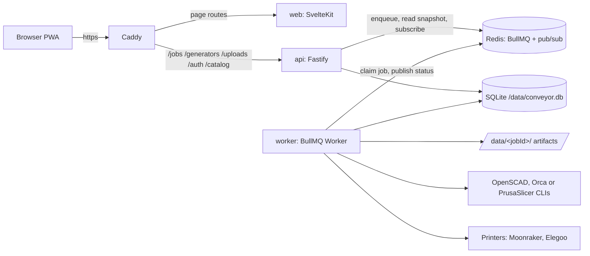

# Architecture (as built today)

Conveyor turns a parameter form into a running print: **generate → slice → transport**. This page maps the
system as it exists on `main`. It is not the rewrite plan; when the code changes, this page changes in the
same PR.

## Services

| Service | Code | Role |
|---|---|---|
| `caddy` | `Caddyfile` | TLS (the PWA's service worker needs https) and path routing. API namespaces never share a prefix with a page route. |
| `web` | `packages/web` | SvelteKit 2 + Svelte 4 PWA on `adapter-node`. Client-side procedural Three.js preview ([ADR 0002](adr/0002-dual-model-preview.md)). |
| `api` | `packages/api` | Fastify REST + WebSocket. Validates requests with zod, checks compatibility, enqueues, relays status to `/jobs/:id/ws`. Session auth (`CONVEYOR_PASSWORD`, `CONVEYOR_AUTH_SECRET`). |
| `worker` | `packages/worker` | BullMQ `Worker` (`WORKER_CONCURRENCY`, default 2). Runs the three stages through in-process plugin adapters ([ADR 0001](adr/0001-plugin-isolation.md)). |
| `redis` | `docker-compose.yml` | Queue, live `job:<id>` snapshot, `job:<id>:status` channel. |

## Packages

| Package | Depends on | Holds |
|---|---|---|
| `@conveyor/shared` | zod | Stage contracts, job and event types, registry, profiles, SQLite access (`bun:sqlite`) |
| `@conveyor/api` | shared, generator plugins | HTTP routes in `src/routes/` (`jobs`, `generators`, `uploads`, `auth`, `catalog`) |
| `@conveyor/worker` | shared, all plugins | Job loop, status bus, profile resolution |
| `@conveyor/web` | shared | Routes `/`, `/history`, `/monitor`, `/settings` |
| `plugins/generators/*` | shared | `gridfinity` (OpenSCAD over the `scad/` submodule), `passthrough` (uploaded STL) |
| `plugins/slicers/*` | shared | `orca`, `prusa` (headless CLIs) |
| `plugins/transports/*` | shared | `moonraker` (Klipper HTTP), `elegoo` (LAN discovery + WebSocket) |

Contracts are in [PLUGINS.md](PLUGINS.md).

## A job's trip

1. The PWA posts `{ generator, params, printerId, profileId }` to `POST /jobs`.
2. The api resolves the printer → transport and the profile → slicer, runs `validateJobRequest`, enqueues on
   BullMQ and answers `202 { jobId }`. The PWA opens `/jobs/:id/ws`.
3. The worker claims the job and publishes `generating`, `slicing`, `transferring`, then printer progress.
   Artifacts land in `/data/<jobId>/` and pass between stages as path handles.
4. On a terminal state the worker writes the job row to SQLite; the Redis snapshot may expire.
5. `POST /jobs/:id/cancel` cancels; `GET /jobs/:id/artifact/:kind` downloads the STL or g-code.

Full sequence with failure paths: [SEQUENCE.md](SEQUENCE.md).

## State and storage

| Store | Truth for |
|---|---|
| Redis | In-flight jobs: queue, live snapshot, status fan-out |
| SQLite (`DB_PATH`) | Printers, profile edits, finished job history |
| `/data/<jobId>/` | `model.stl`, `model.gcode` |
| `/profiles` (read-only) | Bundled slicer profile defaults, the reset target for edits |

Schema and rationale: [DATA-MODEL.md](DATA-MODEL.md).

## Runtime and build

- Bun runs TypeScript directly: no compile step, no `dist/`. `mise.toml` pins the toolchain.
- `CONVEYOR_ENGINE_STUB=1` replaces the engines with stubs so the pipeline runs without OpenSCAD or a slicer.
- Images: three Dockerfiles (`packages/{api,worker,web}/Dockerfile`). `release.yml` publishes multi-arch
  images to GHCR on `v*` tags. The worker image bakes in OpenSCAD and the slicers
  ([M1-WORKER-ENGINES.md](M1-WORKER-ENGINES.md)).

## Known gaps

The audit issues on GitHub (label `audit`) track where today's code falls short of [AGENTS.md](../AGENTS.md):
Svelte 4 instead of a decided UI stack, thrown errors instead of `Result`, comments still in the ratchet
baseline, and low test coverage.
